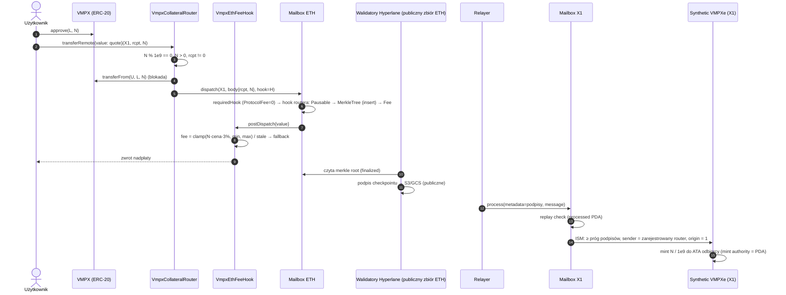
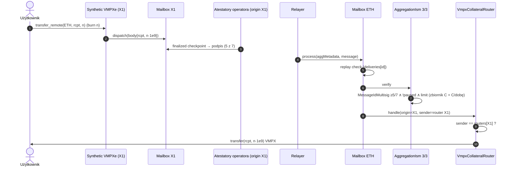
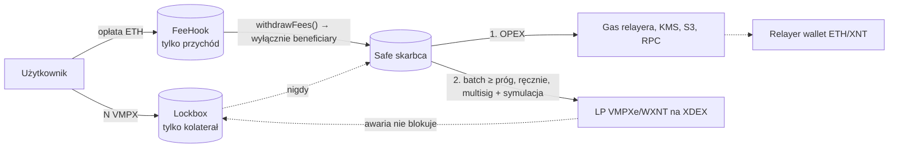

# 03 — Architektura

## Komponenty

| Warstwa | Ethereum (domena 1) | X1 (domena 1479626324, wybrana przez nas) |
|---|---|---|
| Messaging | Mailbox Hyperlane `0xc005…D239` (istniejący) | **własne wdrożenie**: mailbox, validator-announce, multisig-ism-message-id, (opcjonalnie) igp |
| Token | `VmpxCollateralRouter` (lockbox, `HypERC20Collateral` 12.2.0 + 5 ograniczeń) za `TransparentUpgradeableProxy`; `ProxyAdmin` → Timelock | `hyperlane-sealevel-token` (synthetic, Token-2022, 9 dec, `remoteDecimals: 18`) |
| Weryfikacja wiadomości **do** chaina | `StaticAggregationIsm` 3/3: [MessageIdMultisigIsm(atestatory X1, 5/7), PausableIsm, RateLimitedIsm] | multisig-ism-message-id dla origin=1: **wariant A**, publiczny zbiór walidatorów Hyperlane dla Ethereum (6/9; na testnecie Sepolia: Abacus Works, 1/1). Decyzja po etapie A testnetu, niżej |
| Hook routera (kolejność ma znaczenie) | `StaticAggregationHook[PausableHook, MerkleTreeHook, VmpxEthFeeHook]`. **MerkleTreeHook jest obowiązkowy**: własny hook zastępuje domyślny hook Mailboxa (ustalenie H-1) | IGP Sealevel: użytkownik płaci w XNT koszt dostarczenia na Ethereum (M-1) |
| Pauza | `EmergencyPauser`: dowolny pauser zatrzymuje depozyty i odblokowania, wznawia tylko guardian (szczegóły w `13-pause-and-change.md`) | przełączenie ISM tokena na „zamknięty” multisig ISM |
| Off-chain | relayer (operator), monitor pokrycia; podpisy ETH→X1 pochodzą od publicznych walidatorów Hyperlane | atestatory X1→ETH (na węzłach X1 operatora), relayer |
| Własność | `TimelockController` (48 h), proposer = Safe 3/5 | upgrade authority programów, metadata authority i owner tokena = Squads (X1) |

## Dlaczego potrzebne są „walidatory mostu”, skoro operator ma walidatory X1

Walidatory sieci X1 uzgadniają bloki X1. Nie widzą Ethereum, a Ethereum nie widzi ich. Kontrakt na Ethereum nie ma jak sam sprawdzić, że na X1 spalono tokeny. Ktoś musi to zaświadczyć podpisem, a kontrakt musi te podpisy zweryfikować. Atestator Hyperlane to lekki proces (kilkadziesiąt MB RAM) uruchamiany **na tych samych serwerach** co węzły X1. Czyta finalized stan Mailboxa X1 i podpisuje checkpoint **osobnym** kluczem secp256k1.

## Kto podpisuje który kierunek (decyzja po etapie A testnetu, 29–30 paź 2026)

| Kierunek | Kto podpisuje checkpointy | Gdzie jest lista i próg |
|---|---|---|
| **ETH → X1** (mint) | **publiczny zbiór walidatorów Hyperlane dla Ethereum** (wariant A): 6/9 na mainnecie, Abacus Works 1/1 na Sepolii | multisig-ism-message-id na X1, domena 1 (testnet: 11155111); zmiana przez Squads X1 (time-lock 48 h, `15-key-custody.md` §8) |
| **X1 → ETH** (unlock) | **własne atestatory operatora** na węzłach X1 | `MessageIdMultisigIsm` w AggregationIsm 3/3 na Ethereum; zmiana przez Timelock 48 h |

**Dlaczego nie własne atestatory po stronie Ethereum (wariant B):**
- Walidator Hyperlane podpisuje checkpoint dopiero po odbudowaniu **całego** drzewa merkle hooka źródłowego, od liścia 0. Na Ethereum to współdzielony `MerkleTreeHook`, w którym są wiadomości wszystkich tras Hyperlane, nie tylko nasze.
- Na Sepolii oznaczało to ok. 873 tys. liści, indeksowanych od bloku 4517401. Mainnetowy hook jest indeksowany od bloku 18422581.
- Do tego potrzebne jest **archiwalne RPC** z pełną historią logów. Publiczne RPC są przycięte: publicnode trzyma ok. 10 tys. bloków. Darmowy archiwalny endpoint (Tenderly) limitował zapytania i nadrobienie historii zajęłoby ok. 17 h na każdy walidator.
- Na mainnecie wariant B wymagałby płatnego archiwalnego RPC albo własnego węzła archiwalnego dla każdego atestatora. Trzeba by też wiecznie utrzymywać pełną kopię drzewa.
- Publiczny zbiór i tak podpisuje każdą wiadomość tego hooka. Relayer pobiera podpisy anonimowo z ich bucketów (`gs://…`, `s3://…`).
- Po stronie X1 tego problemu nie ma: hook X1 jest nasz i zaczyna się od liścia 0. Dlatego kierunek X1→ETH, który chroni kolaterał, zostaje przy własnych atestatorach.

**Co wariant A zmienia w zaufaniu:** zmowa progu publicznego zbioru (6 z 9) pozwala zmintować VMPXe bez pokrycia na X1. Kolaterału na Ethereum to nie daje. Odblokowania podpisują wyłącznie nasze atestatory, pod limitem dziennym i pauzą, a monitor pokrycia wykrywa nadwyżkę podaży na X1. To samo ryzyko rezydualne co przy przejęciu Squads X1 (`13-pause-and-change.md`).

## Przepływ: depozyt ETH → X1

## Przepływ: wypłata X1 → ETH

Pauza albo przekroczony limit **nie gubi** wiadomości. Wiadomość czeka, a relayer ponawia dostarczenie po wznowieniu albo po odnowieniu limitu (test `test_pauseBlocksUnlockAndResumeRecovers`).

**Jak działa limit X1 → Ethereum (`RateLimitedIsm`, przegląd Codex I-02).** To **zbiornik**, a nie limit „na dobę kalendarzową”:
- pojemność **C** (`maxCapacity`), na starcie pełna;
- uzupełnia się w sposób ciągły o **C na 24 h** (`refillRate = C / 86 400` na sekundę);
- jedna wiadomość może zużyć najwyżej tyle, ile jest w zbiorniku w chwili dostarczenia.

Skutek: w dowolnym oknie 24 h może wyjść **prawie 2C** (pełny zbiornik plus uzupełnienie). Przy incydencie (np. przejęty próg atestatorów) maksymalna strata przed pauzą to C + C × t / 86 400, gdzie t to czas do pauzy. C dobieramy tak, żeby operator był w stanie pokryć 2C z rezerwy (`08-runbook.md`, checklista).

**Wiadomość większa niż C** nigdy nie przejdzie bez zmiany limitu (Codex M-01). Program tokena na X1 (upstream `hyperlane-sealevel-token`) nie zna limitu po stronie Ethereum i pozwala spalić dowolną kwotę. Dlatego:
- strona sprawdza `calculateCurrentLevel()` i `maxCapacity()` tuż przed podpisem i **odmawia** transferu ponad dostępny poziom albo ponad C;
- procedurę odblokowania wiadomości, która mimo to utknęła (np. wysłanej z CLI), opisuje `08-runbook.md` §6a.

## Opłaty i skarbiec (oddzielenie środków)

Cztery pule są rozdzielone kontraktowo albo kluczami:
1. **Kolaterał użytkowników**: tylko lockbox. Rebalancing i LP-vault upstreamu są wyłączone (`addBridge`, `setRecipient`, `deposit` i `mint` revertują).
2. **Przychód projektu**: tylko `VmpxEthFeeHook`. Wypłata trafia wyłącznie do `beneficiary`.
3. **Gas i utrzymanie**: osobne portfele relayera (ETH na Ethereum, XNT na X1), zasilane ze skarbca.
4. **Aktywa LP**: tokeny LP XDEX na osobnym adresie Squads. Nie są wliczane do pokrycia.

## Decimals

- VMPX ma 18 dec, VMPXe 9 dec. Router EVM ma skalę 1/1, a konwersję robi program Sealevel (`convert_decimals`, truncation).
- 108 624 000 × 1e9 = 1,086e17 < u64::MAX (1,8e19). Przy 18 dec na SVM byłby overflow (`svm/decimals-check`, `test_u64Bounds`).
- **Dust:** upstream obciąłby bez ostrzeżenia część poniżej 1e-9. Lockbox odrzuca więc kwoty niepodzielne przez 1e9, a frontend ogranicza wejście do 9 miejsc po przecinku. Minimalna kwota to 1e-9 VMPX (praktycznie ogranicza ją opłata minimalna).
- Kierunek X1 → ETH: mnożenie ×1e9 jest bezstratne.

## Finalność

- **Ethereum → X1:** podpisuje publiczny zbiór Hyperlane według swojej polityki finalności (wariant A, decyzja po testnecie). Od 30 paź 2026 nasz relayer czeka tyle bloków co walidatorzy (decyzja właściciela; Sepolia 2, Ethereum mainnet 15). Na testnecie mint na X1 przychodzi **ok. 1 min** po depozycie (test 1b: 52 s); wcześniej, z `"finalized"`, 13–19 min.
  - **Skąd było 13–19 min (pomiar 30 paź 2026, przed zmianą):** walidator AW podpisał naszą wiadomość **39 s** po bloku (upstream `reorgPeriod` dla Sepolii = 2 bloki). Resztę czasu zajmuje **nasz relayer**, który ma w `testnet/make-agent-config.mjs` ustawione `reorgPeriod: "finalized"` (ok. 2 epoki, ~13 min) i dopiero potem indeksuje wiadomość.
  - **To ustawienie relayera nie jest zabezpieczeniem.** `process()` na X1 może wywołać każdy, kto ma podpis walidatorów. O bezpieczeństwie względem reorga decyduje wyłącznie `reorgPeriod` walidatorów (AW / publicznego zbioru), a czekanie naszego relayera wydłuża tylko czas dla użytkownika.
  - **Mainnet (szacunek):** publiczny zbiór dla Ethereum ma w monorepo (`rust/main/config/mainnet_config.json`, commit `f556e18`) `reorgPeriod: 15`, `confirmations: 2`, blok ~13 s, czyli podpis po ok. 3–4 min. ETH→X1 zajmie wtedy **ok. 4–5 min**, bo relayer używa tego samego `reorgPeriod` co walidatorzy (decyzja właściciela z 30 paź 2026; zmiana tylko w konfiguracji relayera, progi ISM bez zmian).
- **X1 → Ethereum:** agenci Sealevel czytają commitment `finalized`. Historia rebootów X1 (Tachyon 2.0, „Buenos Aires”: rollback ledgera) jest ryzykiem. Rollback po podpisanym checkpoincie może dać odblokowanie bez spalenia. Ograniczają to limit dzienny i procedura z runbooka §4 (pauza przy każdym ogłoszonym restarcie lub rollbacku X1).

## Uprawnienia, które muszą być zweryfikowane po wdrożeniu

| Uprawnienie | Docelowo | Weryfikacja |
|---|---|---|
| owner `VmpxCollateralRouter` | Timelock 48 h ← Safe 3/5 | `owner()` |
| owner `VmpxEthFeeHook` | ten sam Timelock (zmiany parametrów mają dodatkowo wbudowane 3 dni) | `owner()` |
| owner PausableIsm i PausableHook | `EmergencyPauser` (pauserzy: stop, guardian: start). Pauza nie przenosi środków | `owner()`, `guardian()`, `isPauser()` |
| owner ProxyAdmin lockboxa | Timelock 48 h; guardian ma CANCELLER_ROLE | `owner()`, `hasRole()` |
| owner RateLimitedIsm | Timelock | `owner()` |
| mint authority VMPXe | mint PDA (tylko program) | `check-x1.mjs --post-deploy` |
| freeze authority | brak | jw. |
| upgrade authority programów X1 | Squads (X1) albo `none` po stabilizacji | jw. |
| metadata update authority | Squads | jw. |
| owner tokena Sealevel (ISM, routery) | Squads | `hyperlane-sealevel-client token query` |
